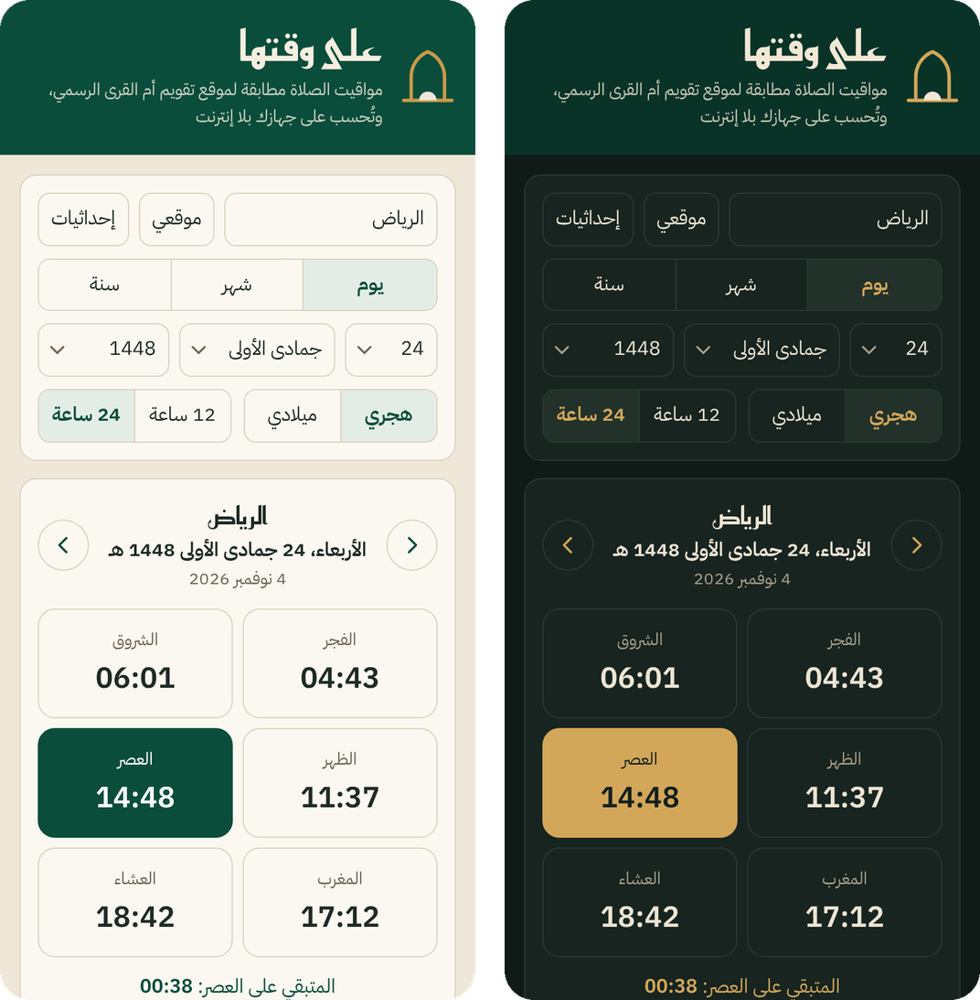
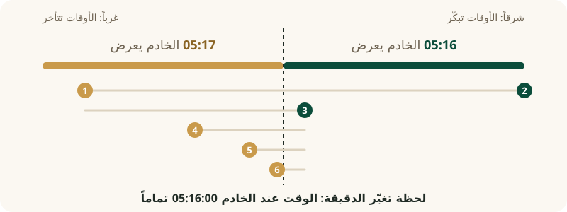

<div align="center">


# On Time Prayer — على وقتها

**Prayer times exactly as the official Umm al-Qura calendar website shows them: to the minute, for any date and any coordinates, offline.**

[](https://github.com/tswq-dev/ontime-prayer/actions/workflows/verify.yml)


[العربية](README.md) | [Specification](ALGORITHM.md) | [Research log](METHOD.md) | [Report a mismatch](../../issues/new?template=mismatch.yml)

</div>

> The name comes from the hadith of Ibn Mas'ud: *"I asked the Prophet ﷺ which deed is most beloved to Allah. He said: prayer on
> its time"* (al-Bukhari and Muslim).

## At a glance

| Checked | Mismatches | 173 Saudi cities, every day 2020–2040 |
|---|---|---|
| **14,657,797** times from the official Umm al-Qura calendar website | **67** only: grazing polar days and two historical days | **0** |

- **An open formula** with no dependencies, in Python and JavaScript, plus a complete specification for porting it to any language.
- **The «على وقتها» website** computes the times on the device, works offline and installs on a phone like an app.
- **Verifiable**: every answer of the official Umm al-Qura calendar website we used is in this repository, and one script re-runs the
  whole check.

> **Note:** this is an unofficial reconstruction from the outputs of the official Umm al-Qura calendar website. It is not the original
> source code and is not affiliated with King Abdulaziz City for Science and Technology (KACST) or any official body. The official
> times are those published by the [official Umm al-Qura calendar website](https://www.ummulqura.org.sa/ar/prayer-times).

## Quick start

```python
from datetime import date
from umm_al_qura_times import prayer_times

prayer_times(date(2027, 3, 20), 21.4225, 39.8262)          # Makkah, zone +3
# {'fajr': '05:09', 'sunrise': '06:25', 'dhuhr': '12:29', 'asr': '15:54',
#  'maghrib': '18:32', 'eid': '06:47', 'isha': '20:02'}
```

```js
const UMQ = require('./js/umq.js');                          // browser: <script src="umq.js"></script>
UMQ.prayerTimes('2027-03-20', 21.4225, 39.8262, 3, 0);       // date, lat, lon, zone, ramadan (1/0)
// { fajr: '05:09', sunrise: '06:25', dhuhr: '12:29', asr: '15:54', maghrib: '18:32', isha: '20:02', eid: '06:47' }
```

These are the times the official Umm al-Qura calendar website shows for Makkah on 20 March 2027. In Ramadan pass `ramadan=True`
(or `1`): Isha is then 120 minutes after Maghrib instead of 90.

<p align="center"></p>

---

## Why

Most prayer apps compute the times with well-known astronomical formulas, and each app picks its own details: the Fajr angle,
refraction, how seconds are rounded. So even an app set to the "Umm al-Qura method" may say 05:16 while the official Umm al-Qura
calendar website says 05:17. The Umm al-Qura calendar is the official reference in Saudi Arabia, but the formula the official
website uses has never been published.

We wanted a formula any app could trust completely: give it the same date and coordinates and it returns what the official Umm
al-Qura calendar website shows, not approximately but exactly. Hence the rule we kept for the whole project: **always go to zero**.
Every difference, even one time in millions, has a cause, and we did not stop until we knew it.

## The difficulty: a minute hides sixty seconds

The server of the official website takes a date, coordinates and a time zone and returns seven times, in whole minutes only. A model
that is off by half a second still matches about 99 % of them, so comparing minutes, however many, proves little.

## The idea: find the moment the minute changes

Moving one degree east makes every time about four minutes earlier, so moving the longitude by a millionth of a degree moves the
time by a tiny fraction of a second. We pick a time, find two longitudes where the server shows two different minutes, and halve
the interval again and again.

<p align="center"></p>

After about 14 requests we know where the minute changes, which gives the server's own time to a fraction of a millisecond, and we
compare that with the model. All data come from the official Umm al-Qura calendar website: complete exports for 173 Saudi cities,
cities around the world, and about 1,700 measurements at minute boundaries.

## The journey: from 99 % to zero

- **Start.** NREL's Solar Position Algorithm (SPA) and Jean Meeus's methods with the Umm al-Qura conventions: Fajr at 18.5° below
  the horizon, Asr at shadow length equal to the object, Isha 90 minutes after Maghrib (120 in Ramadan). Most times matched, not all.
- **How the server computes.** Dhuhr, sunrise and Maghrib are iterated until they settle; when the iteration stops; and the moment
  the day's computation starts (local midnight).
- **The Earth's orbit table.** The server's VSOP87 table is rounded in a few rows. That discovery removed every empirical correction
  we had been adding.
- **First zero.** Every time in the 173-city export for ten years (4,864,587 values).
- **Outside Saudi Arabia.** World cities in their own time zones, cities above 48° latitude, polar days, and how the website rounds
  GPS coordinates before sending them.
- **Hunting for holes.** We deliberately tried to break the model: times at minute boundaries from 1940 to 2100 and GPS points all
  over Saudi Arabia, islands, borders and the Empty Quarter included.
- **Outside review.** Consultants (AI agents with roles: statistician, code reviewer, attacker, numerical analyst, astronomer), blind
  tests on frozen code, and an independent JavaScript port written from the specification alone that reproduced the same results.
  ΔT was read directly from the server at 48 dates between the years 1000 and 2000.
- **Doubling the check.** 2,804 new city-years never used to build the model.

Every step was the discovery of how the server computes, not fitting numbers to data; the empirical corrections tried on the way
were all removed once the real cause appeared. Everything, dead ends included, is in the [research log](METHOD.md).

## Results

**14,657,797 server values, 67 mismatches:**

| Data (server answers) | Values | Mismatches |
|---|---|---|
| 173 official Saudi cities, every day 2020–2040 | 9,289,581 | 0 |
| Random points all over Saudi Arabia, 1950–2150 | 1,641,381 | 25 (two historical days: 1997-03-14, 1999-12-29) |
| Arar, every day 2001–2149 | 352,828 | 0 |
| 114 world cities in their own time zones | 2,039,688 | 0 |
| 59 further places, incl. Arctic/Antarctic and unusual time zones | 777,616 | 42 (7 days when the Sun barely grazes the horizon) |
| Minute-boundary tests, whole years and random world points 1940–2150 | 556,703 | 0 |
| **Total** | **14,657,797** | **67** |

The strongest evidence is not the number of values but blind tests on frozen code: 320 of 320 Saudi times within 0.1 ms of a
minute change, 363,013 times at random GPS points, and the Arar years.

## How it differs from other apps and websites

Many prayer apps and websites offer an "Umm al-Qura method", but it is usually just two settings: Fajr at 18.5° and Isha 90 minutes
after Maghrib. The rest is a generic astronomical formula and a rounding rule that each app chooses.

To measure the difference we compared [adhan](https://github.com/batoulapps/adhan-js), one of the most popular open-source
prayer-time libraries, using its "Umm al-Qura" method (with the Ramadan rule added), with the official Umm al-Qura calendar website
for 173 Saudi cities, every day from 2025 to 2035: 4,169,646 values.

| Computation | Values different from the official website | Days with at least one different time |
|---|---|---|
| The library with its default settings | 51 % | 96 % |
| The library with the official website's rounding | 15 % (Fajr 40 %, Asr 31 %, others 4–5 %) | 62 % |
| **This formula** | **0** | **0** |

The difference is almost always one minute, for two reasons:

1. **Rounding.** The official website drops fractions of a second, then rounds sunrise down to the minute and every other time up.
   Libraries usually round to the nearest minute, which alone changes about half of the times.
2. **Computational details.** When the day's computation starts, which orbit table and which ΔT are used, and at which moment the
   Sun's declination is taken. A few seconds are enough to change a time that lies near a minute boundary.

**What is new here:** these details were unknown, so apps could only approximate. They are now fully written down in
`ALGORITHM.md`, together with five constants measured from the server itself: a sidereal-time offset (+0.146457″), an obliquity
offset (−0.039131″), a sunrise offset (+3.2 ms) and two for the Fajr rule above 48° latitude. Any phone app or website can embed the
formula as it is (MIT, no dependencies, offline) and show exactly the times of the official Umm al-Qura calendar website.

The comparison is reproducible: `tools/compare/adhan.mjs`, results in `data/compare/`.

## Usage

1. **The «على وقتها» website** (`site/`): one page that computes on the device, works offline after the first visit and installs
   on a phone. 173 Saudi cities, GPS or typed coordinates, day, month and year views in the Hijri or Gregorian calendar.
2. **Python:** `umm_al_qura_times.py`, one file, no dependencies (see Quick start).
3. **JavaScript:** `js/umq.js`, browser and Node, no dependencies.
4. **Any other language:** the full specification is `ALGORITHM.md`; every server answer is in `data/vectors.csv.gz` to check your
   port.

Ramadan follows the Umm al-Qura Hijri calendar. In a browser the built-in `islamic-umalqura` calendar is enough: it matched the
Hijri date of the official Umm al-Qura calendar website on every day from 1940 to 2150.

**Check it yourself** (this also runs automatically on GitHub whenever the formula or the data change):

```bash
python3 tools/verify.py     # full check, Python (1-2 minutes)
node js/verify.js           # the same check, JavaScript
```

## Repository contents

| Path | Contents |
|---|---|
| `umm_al_qura_times.py` | Reference implementation (Python) |
| `js/` | JavaScript port and its full check |
| `site/` | The «على وقتها» website |
| `ALGORITHM.md` | Full specification for porting |
| `METHOD.md` | Research log: every round, dead ends included |
| `data/vectors.csv.gz` | Every server answer used: one row per date, place and time zone |
| `data/expected_mismatches.json` | The 67 known mismatches |
| `data/raw/` | Raw data as collected |
| `tools/` | Verification script and the browser scripts used to collect the data |
| `tools/compare/` | Comparison of the adhan library with the official website |
| `docs/reviews/` | Reviews by the consultants (AI agents) |

## Known limits

We do not claim "100 % guaranteed", but "matches everything we checked, with known limits":

- **Not the original code.** The confidence is statistical: in Saudi Arabia the model error is below about 7 microseconds, so a time
  lying closer than that to a minute boundary could differ. This is very rare.
- **If the server code of the official Umm al-Qura calendar website changes**, the formula may differ from that day; we will update it.
- **Grazing polar days** and two historical Saudi days (1997 and 1999) are not reproduced yet.

## Found a mismatch?

Open a [mismatch report](../../issues/new?template=mismatch.yml) with the date, coordinates, time zone and the time shown by the
official Umm al-Qura calendar website. Every new difference is investigated until we are back at zero.

## License and data

- **Code:** MIT (`LICENSE`).
- **Data** in `data/` are outputs of the official Umm al-Qura calendar website, collected from the public service at a low request
  rate for verification. They are not covered by the MIT license; their rights belong to their owners.
- **Fonts** in `site/fonts/` (Reem Kufi, IBM Plex Sans Arabic): SIL Open Font License.

## Citation

If you use this work in research or a project, the citation is in `CITATION.cff` ("Cite this repository" on GitHub).

## Disclosure

The analysis, code and documents were produced with the help of Anthropic's Claude (AI). The reviews in `docs/reviews/` are AI
agents, not independent human reviewers.
