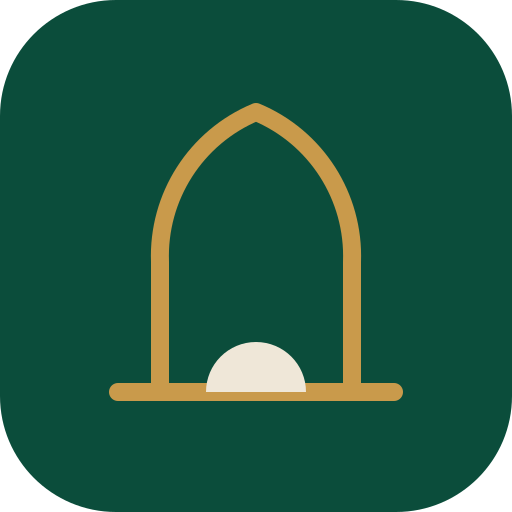
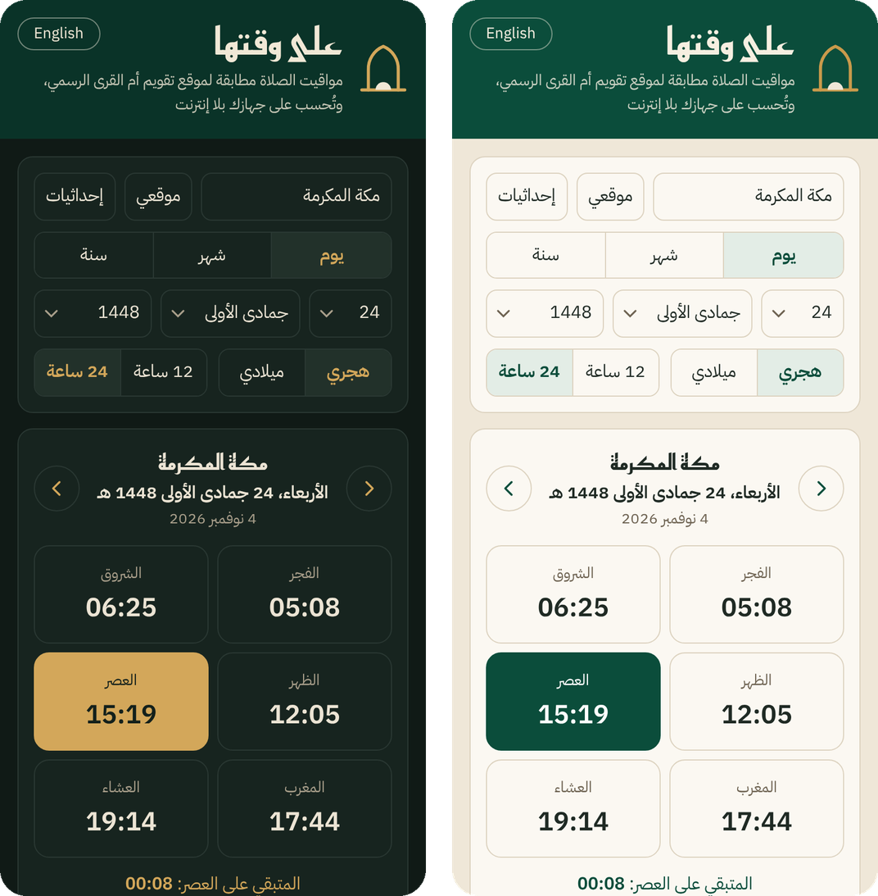
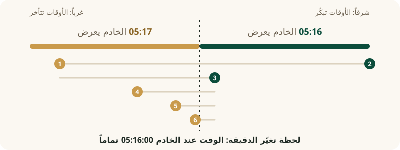

<div dir="rtl" align="center">



# على وقتها — On Time Prayer

**مواقيت الصلاة كما يعرضها موقع تقويم أم القرى الرسمي، بالدقيقة، لأي تاريخ وأي إحداثيات، وبلا إنترنت.**

[](https://github.com/tswq-dev/ontime-prayer/actions/workflows/verify.yml)


[الموقع](https://ontime-prayer.pages.dev) | [English](README.en.md) | [المواصفة](ALGORITHM.md) | [سجل البحث](METHOD.md) | [الإبلاغ عن اختلاف](../../issues/new?template=mismatch.yml)

</div>

<div dir="rtl">

> الاسم من حديث ابن مسعود رضي الله عنه: سألتُ النبي ﷺ: أيُّ العمل أحبُّ إلى الله؟ قال: «الصلاةُ على وقتها» (متفق عليه).

## باختصار

| فحصنا | الاختلافات | 173 مدينة سعودية، كل يوم 2020–2040 |
|---|---|---|
| **14,657,797** وقتاً من موقع تقويم أم القرى الرسمي | **67** فقط: أيام قطبية ويومان تاريخيان | **0** اختلاف |

- **معادلة مفتوحة** بلا مكتبات، بخمس لغات: بايثون، وجافاسكربت، وKotlin لأندرويد، وSwift لآيفون، وDart لتطبيقات Flutter.
  وكل نسخة تُفحص تلقائياً على كل البيانات، ومعها مواصفة كاملة لمن ينقلها إلى أي لغة أخرى.
- **[موقع «على وقتها»](https://ontime-prayer.pages.dev)** بالعربية والإنجليزية، يحسب الأوقات على الجهاز بلا إنترنت، ويُثبَّت على الجوال كالتطبيق.
- **قابلة للتحقق**: كل أجوبة موقع تقويم أم القرى الرسمي التي استعملناها موجودة هنا، وسكربت واحد يعيد الفحص كاملاً.

> **تنبيه:** هذه إعادة بناء غير رسمية من مخرجات موقع تقويم أم القرى الرسمي، وليست الكود الأصلي، ولا تتبع مدينة الملك عبدالعزيز
> للعلوم والتقنية ولا أي جهة رسمية. الأوقات الرسمية هي ما ينشره [موقع تقويم أم القرى الرسمي](https://www.ummulqura.org.sa/ar/prayer-times).

## البدء السريع

</div>

```python
from datetime import date
from umm_al_qura_times import prayer_times

prayer_times(date(2027, 3, 20), 21.426666, 39.831666)      # Makkah, zone +3
# {'fajr': '05:09', 'sunrise': '06:25', 'dhuhr': '12:29', 'asr': '15:54',
#  'maghrib': '18:32', 'eid': '06:47', 'isha': '20:02'}
```

```js
const UMQ = require('./js/umq.js');                          // browser: <script src="umq.js"></script>
UMQ.prayerTimes('2027-03-20', 21.426666, 39.831666, 3, 0);   // date, lat, lon, zone, ramadan (1/0)
// { fajr: '05:09', sunrise: '06:25', dhuhr: '12:29', asr: '15:54', maghrib: '18:32', isha: '20:02', eid: '06:47' }
```

```kotlin
UmmAlQura.prayerTimes("2027-03-20", 21.426666, 39.831666)                       // Kotlin (Android)
```

```swift
UmmAlQura.prayerTimes(date: "2027-03-20", lat: 21.426666, lon: 39.831666)       // Swift (iOS)
```

```dart
UmmAlQura.prayerTimes('2027-03-20', 21.426666, 39.831666)                       // Dart (Flutter)
```

<div dir="rtl">

النتيجة نفسها التي يعرضها موقع تقويم أم القرى الرسمي لمكة المكرمة في 20 مارس 2027، بإحداثياتها في قائمة مدن موقع تقويم أم القرى الرسمي. في رمضان يُمرَّر `ramadan=True` (أو `1`)، فيصير العشاء
بعد المغرب بمئة وعشرين دقيقة.

<p align="center"></p>

---

## لماذا بدأنا؟

أغلب تطبيقات الصلاة تحسب الأوقات بمعادلات فلكية معروفة، وكل تطبيق يختار تفاصيله: زاوية الفجر، وانكسار الضوء، وطريقة تقريب
الثواني. فحتى لو ضبطتَ تطبيقك على «طريقة أم القرى» قد يقول 05:16، بينما يقول موقع تقويم أم القرى الرسمي 05:17. وتقويم أم القرى هو
المرجع الرسمي في المملكة، لكن المعادلة التي يحسب بها موقع تقويم أم القرى الرسمي أوقات الصلاة غير منشورة.

أردنا معادلة يثق بها أي تطبيق ثقة تامة: إذا أُعطيت نفس التاريخ والإحداثيات أعطت نفس ما يعرضه موقع تقويم أم القرى الرسمي، لا تقريباً
بل حرفياً. ومن هنا جاءت قاعدة العمل طوال المشروع: **«دائماً وأبداً نكمل للصفر»**. أي اختلاف، ولو في وقت واحد من ملايين، له سبب،
ولا نتوقف حتى نعرفه.

## الصعوبة: الدقيقة تخفي الثواني

خادم موقع تقويم أم القرى الرسمي يأخذ التاريخ والإحداثيات والمنطقة الزمنية، ويعطي سبعة أوقات بالدقيقة فقط. والدقيقة تخفي ستين ثانية،
فمعادلة خاطئة بنصف ثانية تطابق قرابة 99٪ من الأوقات. لذلك لا تكفي مقارنة الدقائق مهما كثرت: النجاح في 99٪ لا يعني أن المعادلة صحيحة.

## الفكرة التي حلّتها: نبحث عن لحظة تغيّر الدقيقة

التحرك شرقاً درجة طول واحدة يجعل الأوقات أبكر بنحو أربع دقائق. فإذا حرّكنا خط الطول بجزء من مليون من الدرجة، تحرّك الوقت جزءاً
صغيراً جداً من الثانية. نختار وقتاً، ونجد خطَّي طول يعطي الخادم عندهما دقيقتين مختلفتين، ثم نقسم المسافة بينهما نصفين مرة بعد مرة.

<p align="center"></p>

بعد نحو 14 سؤالاً للخادم نعرف أين تتغير الدقيقة بالضبط، أي نعرف الوقت عند الخادم بأجزاء من الألف من الثانية، لا الدقيقة المقرّبة
فقط. ثم نقارنه بمعادلتنا. وجمعنا كل البيانات من موقع تقويم أم القرى الرسمي: تصدير كامل لأوقات 173 مدينة سعودية، ومدن من العالم،
وقرابة 1,700 قياس عند حافة الدقيقة.

## الرحلة: من 99٪ إلى الصفر

- **البداية.** خوارزمية موقع الشمس (SPA) من المختبر الوطني الأمريكي للطاقة المتجددة، وطرق كتاب Jean Meeus، مع اصطلاحات تقويم
  أم القرى: الفجر عند 18.5 درجة تحت الأفق، والعصر عند ظل الشيء مثله، والعشاء بعد المغرب بتسعين دقيقة (ومئة وعشرين في رمضان).
  طابقت هذه البداية الغالبية العظمى من الأوقات، لا كلها.
- **طريقة الحساب نفسها.** كيف يحسب الخادم الظهر والشروق والمغرب: بالتكرار حتى يستقر الوقت، ومتى يتوقف، ومن أي لحظة يبدأ حساب
  اليوم (منتصف الليل بالتوقيت المحلي).
- **جدول مدار الأرض.** الجدول (VSOP87) عند الخادم مقرّب في بعض صفوفه. بهذا الاكتشاف حذفنا كل التصحيحات التجريبية التي كنا نضيفها.
- **أول صفر.** كل الأوقات في تصدير 173 مدينة سعودية لعشر سنوات (4,864,587 وقتاً).
- **خارج السعودية.** مدن العالم بمناطقها الزمنية، والمدن فوق خط عرض 48°، والأيام القطبية، وتقريب الموقع لإحداثيات GPS قبل إرسالها.
- **البحث عن ثغرة.** بحثنا عمداً عن ثغرة في معادلتنا: أوقات على حافة الدقيقة من 1940 إلى 2100، ونقاط GPS في كل أنحاء المملكة حتى
  الجزر والحدود والربع الخالي.
- **مراجعة من خارج الفريق.** عرضنا العمل على مستشارين (وكلاء ذكاء اصطناعي بأدوار: إحصائي، ومراجع كود، ومهاجم، وخبير حسابات عددية،
  وفلكي)، واختبار أعمى على كود مجمّد. وكتب أحدهم المعادلة بلغة JavaScript من المواصفة وحدها دون أن يرى الكود، فوصل إلى النتيجة
  نفسها. وقسنا فرق الزمن الفلكي (ΔT) عند الخادم مباشرة في 48 تاريخاً من سنة 1000 إلى 2000.
- **مضاعفة التحقق.** 2,804 سنة كاملة لمدن ونقاط جديدة لم تُستعمل في البناء أبداً.

كل خطوة كانت اكتشاف طريقة يحسب بها الخادم، لا ضبط أرقام لتطابق البيانات. والتصحيحات التجريبية التي جربناها في الطريق حُذفت كلها
عندما ظهر السبب الحقيقي. والتفاصيل كلها، ومنها الطرق المسدودة، في [سجل البحث](METHOD.md).

## النتيجة

**14,657,797 وقتاً** من الخادم، و**67 اختلافاً** فقط:

| البيانات (أجوبة الخادم) | الأوقات | الاختلافات |
|---|---|---|
| 173 مدينة سعودية رسمية، كل يوم 2020–2040 | 9,289,581 | 0 |
| نقاط عشوائية في كل السعودية، 1950–2150 | 1,641,381 | 25 (يومان تاريخيان: 14 مارس 1997 و29 ديسمبر 1999) |
| مدينة عرعر، كل يوم 2001–2149 | 352,828 | 0 |
| 114 مدينة في العالم بمناطقها الزمنية | 2,039,688 | 0 |
| 59 مكاناً آخر، منها القطبان ومناطق زمنية نادرة | 777,616 | 42 (7 أيام قطبية تكاد الشمس فيها تلامس الأفق) |
| اختبارات حافة الدقيقة وسنوات كاملة ونقاط عشوائية في العالم 1940–2150 | 556,703 | 0 |
| **المجموع** | **14,657,797** | **67** |

أقوى دليل ليس كثرة الأوقات، بل الاختبارات العمياء على كود مجمّد: 320 من 320 وقتاً سعودياً على بعد جزء من عشرة آلاف من الثانية
من تغيّر الدقيقة، و363,013 وقتاً لنقاط GPS عشوائية، وسنوات عرعر كاملة.

## ما الفرق عن التطبيقات والمواقع الأخرى؟

كثير من تطبيقات الصلاة ومواقعها فيها خيار «طريقة أم القرى»، لكنه في الغالب زاويتان فقط: الفجر عند 18.5 درجة، والعشاء بعد
المغرب بتسعين دقيقة. والباقي معادلة فلكية عامة يختار كل تطبيق تفاصيلها، وطريقة تقريب يختارها أيضاً.

لنعرف حجم الفرق قارنّا مكتبة [adhan](https://github.com/batoulapps/adhan-js)، وهي من أشهر المكتبات المفتوحة لحساب أوقات الصلاة،
بخيار «طريقة أم القرى» فيها (وأضفنا لها قاعدة رمضان)، مع أوقات موقع تقويم أم القرى الرسمي في 173 مدينة سعودية لكل يوم من 2025
إلى 2035، أي 4,169,646 وقتاً:

| الحساب | الأوقات المختلفة عن موقع تقويم أم القرى الرسمي | الأيام التي فيها وقت مختلف واحد على الأقل |
|---|---|---|
| المكتبة بإعداداتها الافتراضية | 51٪ | 96٪ |
| المكتبة بعد توحيد طريقة التقريب مع موقع تقويم أم القرى الرسمي | 15٪ (الفجر 40٪، والعصر 31٪، والباقي 4–5٪) | 62٪ |
| **معادلتنا** | **0** | **0** |

الفرق في أغلبه دقيقة واحدة، وسببه أمران:

1. **التقريب.** موقع تقويم أم القرى الرسمي يحذف أجزاء الثانية، ثم يقرّب الشروق إلى الدقيقة السابقة وباقي الأوقات إلى الدقيقة
   التالية. والمكتبات في الغالب تقرّب إلى أقرب دقيقة، وهذا وحده يغيّر قرابة نصف الأوقات.
2. **تفاصيل الحساب.** من أي لحظة يبدأ حساب اليوم، وأي جدول لمدار الأرض، وأي قيمة لفرق الزمن الفلكي، وعند أي لحظة يُحسب ميل
   الشمس. يكفي فرق ثوانٍ قليلة في هذه التفاصيل ليتغير وقت يقع قرب حافة الدقيقة.

**ما الجديد هنا؟** كانت هذه التفاصيل غير معروفة، فلم يكن أمام أي تطبيق إلا التقريب. الآن هي مكتوبة كاملة في `ALGORITHM.md`،
ومعها خمسة ثوابت قسناها من الخادم نفسه: إزاحة الزمن النجمي (+0.146457 ثانية قوسية)، وإزاحة ميل محور الأرض (−0.039131 ثانية قوسية)،
وإزاحة الشروق (+3.2 جزء من الألف من الثانية)، واثنان لقاعدة الفجر فوق خط عرض 48°. فأي تطبيق جوال أو موقع يقدر يضع المعادلة فيه
كما هي (رخصة MIT، بلا مكتبات، تعمل على الجهاز بلا إنترنت)، ويعرض نفس أوقات موقع تقويم أم القرى الرسمي حرفياً.

المقارنة قابلة للإعادة: `tools/compare/adhan.mjs`، ونتائجها في `data/compare/‎`.

## طرق الاستخدام

1. **[موقع «على وقتها»](https://ontime-prayer.pages.dev)** (مجلد `site/‎`): صفحة واحدة تحسب الأوقات على الجهاز بلا إنترنت بعد أول فتحة، وتُثبَّت على الجوال كالتطبيق.
   فيها 173 مدينة سعودية، وتحديد الموقع أو إدخال الإحداثيات، وعرض اليوم والشهر والسنة بالتقويم الهجري أو الميلادي، بالعربية
   والإنجليزية.
2. **بايثون:** `umm_al_qura_times.py`، ملف واحد بلا مكتبات خارجية (مثاله في البدء السريع).
3. **جافاسكربت:** `js/umq.js`، للمتصفح وNode، بلا مكتبات.
4. **تطبيقات الجوال:** `ports/kotlin/UmmAlQura.kt` لأندرويد، و`ports/swift/UmmAlQura.swift` لآيفون، و`ports/dart/umm_al_qura.dart`
   لـ Flutter. ملف واحد لكل لغة بلا مكتبات، وكل نسخة تُفحص تلقائياً على الأوقات الـ14,657,797 مع كل تعديل.
5. **لغة أخرى:** المواصفة الكاملة في `ALGORITHM.md`، وكل أجوبة الخادم في `data/vectors.csv.gz` لتتحقق من نسختك.

يُعرف رمضان من التاريخ الهجري في تقويم أم القرى. في المتصفح يكفي تقويم `islamic-umalqura` المدمج، وقد طابق التاريخ الهجري في موقع
تقويم أم القرى الرسمي في كل يوم من 1940 إلى 2150.

**التحقق بنفسك** (ويشتغل تلقائياً على GitHub مع كل تعديل في المعادلة أو البيانات):

</div>

```bash
python3 tools/verify.py     # full check, Python (1-2 minutes)
node js/verify.js           # the same check, JavaScript
```

<div dir="rtl">

## محتويات المستودع

| المسار | المحتوى |
|---|---|
| `umm_al_qura_times.py` | التنفيذ المرجعي (بايثون) |
| `js/‎` | نسخة جافاسكربت وفحصها الكامل |
| `ports/‎` | نسخ Kotlin وSwift وDart، ولكل نسخة فحص كامل |
| `site/‎` | موقع «على وقتها» |
| `ALGORITHM.md` | المواصفة الكاملة لمن ينقل المعادلة إلى لغة أخرى |
| `METHOD.md` | سجل البحث: كل جولة، ومنها الطرق المسدودة |
| `data/vectors.csv.gz` | كل أجوبة الخادم المستعملة: صف لكل تاريخ ومكان ومنطقة زمنية |
| `data/expected_mismatches.json` | الاختلافات الـ67 المعروفة |
| `data/raw/‎` | البيانات الخام كما جُمعت |
| `tools/‎` | سكربت الفحص، وسكربتات المتصفح التي جمعنا بها البيانات |
| `tools/compare/‎` | مقارنة مكتبة adhan بموقع تقويم أم القرى الرسمي |
| `docs/brief/‎` | ورقة تعريفية من صفحتين (عربي وإنجليزي) للجهات والتطبيقات |
| `docs/reviews/‎` | مراجعات المستشارين (وكلاء ذكاء اصطناعي) |

## حدود معروفة

لا نقول «مضمونة 100٪»، بل «مطابقة في كل ما فحصناه، مع حدود معروفة»:

- **ليست الكود الأصلي.** الثقة إحصائية: خطأ المعادلة في السعودية أقل من نحو 7 أجزاء من المليون من الثانية، فقد يختلف وقت يقع أقرب
  من ذلك إلى حافة الدقيقة، وهذا نادر جداً.
- **إذا تغيّر كود خادم موقع تقويم أم القرى الرسمي** قد تختلف المعادلة من يومها، ونحدّثها حينها.
- **الأيام القطبية** التي تكاد الشمس فيها تلامس الأفق، ويومان تاريخيان في السعودية (1997 و1999)، لم نعِد إنتاجها بعد.

## وجدت اختلافاً؟

افتح [بلاغ اختلاف](../../issues/new?template=mismatch.yml)، واكتب فيه التاريخ والإحداثيات والمنطقة الزمنية، والوقت الذي يعرضه موقع
تقويم أم القرى الرسمي. كل اختلاف جديد نبحث سببه حتى نصل للصفر.

## الرخصة والبيانات

- **الكود** برخصة MIT (`LICENSE`).
- **البيانات** في `data/‎` مخرجات موقع تقويم أم القرى الرسمي، جمعناها من الخدمة العامة بمعدل طلبات منخفض لغرض التحقق. لا تشملها رخصة
  MIT، وحقوقها لأصحابها.
- **الخطوط** في `site/fonts/‎` (ريم كوفي، وIBM Plex Sans Arabic) برخصة SIL Open Font License.

## الاقتباس

إن استعملت هذا العمل في بحث أو مشروع، فالاقتباس في `CITATION.cff`، ويظهر في GitHub تحت «Cite this repository».

## إفصاح

أُنجز التحليل والبرمجة والتوثيق بمساعدة نموذج الذكاء الاصطناعي Claude من Anthropic. والمراجعات في `docs/reviews/‎` من وكلاء ذكاء
اصطناعي، وليست مراجعة بشرية مستقلة.

</div>
